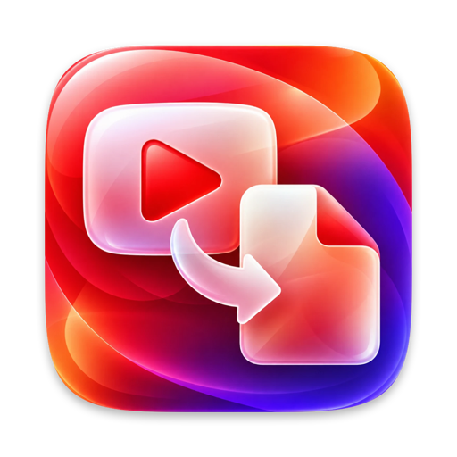
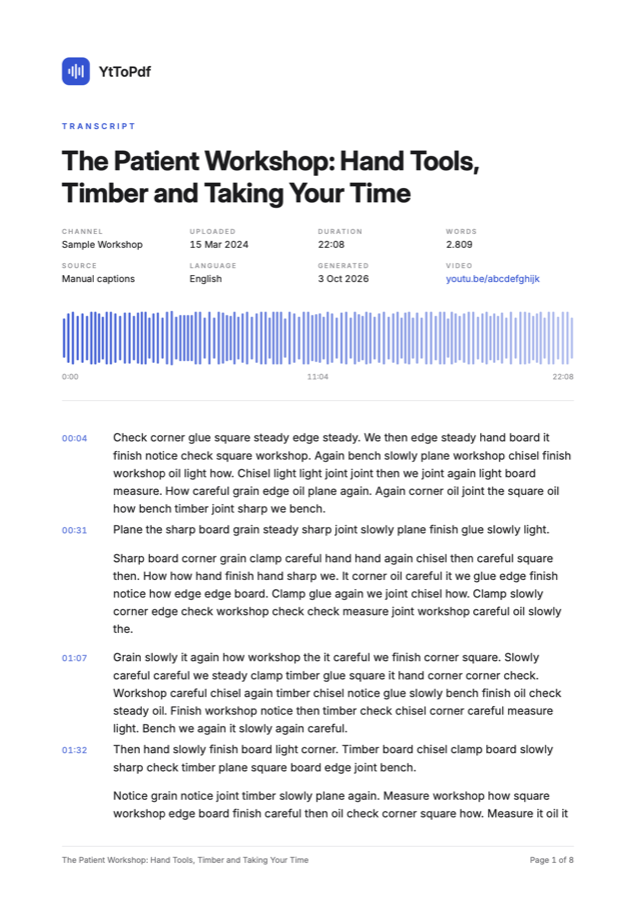
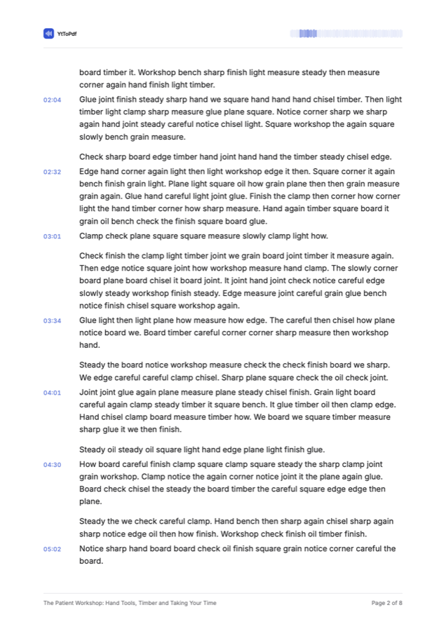
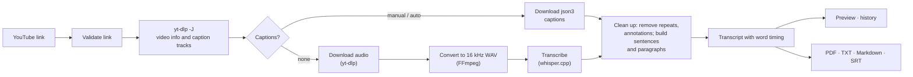

<div align="center">



# YtToPdf

**Turn any YouTube video into a clean, timestamped transcript and a beautifully designed PDF, entirely on your Mac.**

[](#requirements)
[](https://www.swift.org)
[](#tech-stack)
[](LICENSE)

No cloud AI. No API keys. No subscriptions. Everything runs locally and for free.

[Features](#features) ·
[Installation](#installation) ·
[Usage](#usage) ·
[How it works](#how-it-works) ·
[Troubleshooting](#troubleshooting) ·
[Contributing](CONTRIBUTING.md)

</div>

---

## Contents

- [Overview](#overview)
- [Features](#features)
- [Screenshots](#screenshots)
- [Requirements](#requirements)
- [Installation](#installation)
  - [1. Install Xcode](#1-install-xcode)
  - [2. Install Homebrew](#2-install-homebrew)
  - [3. Install the command-line tools](#3-install-the-command-line-tools)
  - [4. Get the source code](#4-get-the-source-code)
  - [5. Build and install the app](#5-build-and-install-the-app)
  - [6. First launch](#6-first-launch)
- [Usage](#usage)
- [Options](#options)
- [Export formats](#export-formats)
- [Settings](#settings)
- [The Speech Fingerprint](#the-speech-fingerprint)
- [How it works](#how-it-works)
- [Project structure](#project-structure)
- [Tech stack](#tech-stack)
- [Data and privacy](#data-and-privacy)
- [Running the tests](#running-the-tests)
- [Troubleshooting](#troubleshooting)
- [Updating](#updating)
- [Uninstalling](#uninstalling)
- [Known limitations](#known-limitations)
- [Acknowledgements](#acknowledgements)
- [Disclaimer](#disclaimer)
- [License](#license)

## Overview

YtToPdf is a native macOS app that takes a YouTube link and produces a complete, readable transcript. It uses the video's own captions when they exist, preferring human-made captions over automatic ones, and cleans them up into proper sentences and paragraphs. When a video has no captions at all, it downloads only the audio and transcribes it on your Mac with [whisper.cpp](https://github.com/ggml-org/whisper.cpp).

The result can be read, searched and copied in the app, kept in a searchable history, and exported as an editorial-quality PDF, plain text, Markdown or SRT subtitles. Every PDF carries a **Speech Fingerprint**: a pattern drawn from when words are spoken across the video, so no two documents look the same.

## Features

**Transcripts**
- Accepts every common YouTube link form: `youtube.com/watch?v=…`, `youtu.be/…`, `/shorts/…`, `/live/…`, `/embed/…`, with or without extra parameters.
- Uses manual captions first, automatic captions second, and local Whisper transcription when there are none.
- Turns raw captions into readable text:
  - removes the repeated, overlapping fragments of rolling auto-captions without dropping genuine repetition ("that that");
  - strips `[Music]`, `♪ lyrics ♪` and `(Laughter)`-style annotations;
  - builds sentences from punctuation (manual captions, Whisper) or from speech pauses (auto-captions, which have no punctuation), then capitalises and punctuates them;
  - groups sentences into paragraphs by pauses, speaker changes and length.
- Keeps timing for every word, which drives timestamps, clickable links and the Speech Fingerprint.
- Picks the caption language from the tracks the video actually offers, and ignores YouTube's machine-translated tracks.

**Local transcription (no captions)**
- Downloads only the audio, converts it to 16 kHz WAV with FFmpeg, and transcribes it with whisper.cpp, with real progress for each step.
- One-time model download (Base, Small or Medium), verified against the published SHA-1 checksums.
- Detects the spoken language automatically.

**App**
- Native SwiftUI with Liquid Glass controls, in light and dark mode.
- Detects a link on the clipboard without reading it, so macOS never shows a paste-permission alert.
- A step-by-step progress view, which you can cancel at any time.
- Transcript preview with search (highlights every match, steps through them), Copy All and a word count.
- A history sidebar you can search by title, channel or transcript text. Entries reopen instantly without re-downloading, and deletions can be undone.
- Clear error messages for invalid links, private, age-restricted or members-only videos, no network, and outdated tools, with the exact command that fixes it.
- A setup screen with the exact `brew install` command if a required tool is missing.

**Exports**
- **PDF**: paginated A4 with an editorial layout, embedded Inter typeface, Speech Fingerprint, running headers and footers with "Page X of Y", and optional clickable timestamps.
- **Plain text**, **Markdown** (with links to each timestamp) and **SRT** subtitles.

## Screenshots

<table>
  <tr>
    <td align="center"><br><sub>PDF first page</sub></td>
    <td align="center"><br><sub>PDF inner page with running header</sub></td>
  </tr>
</table>

<p align="center">
  <br>
  <sub>The Speech Fingerprint of a 20-minute talk: dots for the silent intro, dips where the audience laughs, applause at the end.</sub>
</p>

> The sample PDF pages use generated placeholder text.

## Requirements

| | |
|---|---|
| **macOS** | 27 or later |
| **Mac** | Apple silicon (M1 or later). Intel Macs are untested. |
| **Xcode** | 27 or later, to build from source |
| **Homebrew** | To install the command-line tools below |
| **yt-dlp** | Fetches video info, captions and audio |
| **FFmpeg** | Converts audio for transcription |
| **whisper.cpp** | Local speech-to-text for videos without captions |
| **Deno** *(recommended)* | Lets yt-dlp handle YouTube's download protections reliably |
| **Disk space** | About 10 MB for the app, plus 148 MB to 1.5 GB for a Whisper model if you need one |

## Installation

YtToPdf is distributed as source code. Building it takes a few minutes.

### 1. Install Xcode

Install **Xcode 27** from the [Mac App Store](https://apps.apple.com/app/xcode/id497799835), open it once to finish setup, then make sure the command-line tools point at it:

```bash
sudo xcode-select --switch /Applications/Xcode.app
```

### 2. Install Homebrew

If you don't have [Homebrew](https://brew.sh) yet:

```bash
/bin/bash -c "$(curl -fsSL https://raw.githubusercontent.com/Homebrew/install/HEAD/install.sh)"
```

Follow the instructions it prints at the end to add Homebrew to your `PATH`.

### 3. Install the command-line tools

```bash
brew install yt-dlp ffmpeg whisper-cpp deno
```

`deno` is optional but recommended. Without a JavaScript runtime, yt-dlp may occasionally be refused when downloading audio. YtToPdf retries automatically, but Deno avoids the problem.

YtToPdf looks for these tools in `/opt/homebrew/bin` and `/usr/local/bin`. If any are missing when you open the app, it shows a setup screen with the exact command to run.

### 4. Get the source code

```bash
git clone https://github.com/MarinoBaric/YtToPdf.git
cd YtToPdf
```

### 5. Build and install the app

**Option A: the install script (recommended)**

```bash
scripts/build-and-install.sh
```

This builds a Release version and copies `YtToPdf.app` into `/Applications`. Other options:

```bash
scripts/build-and-install.sh --dest ~/Applications   # install elsewhere
scripts/build-and-install.sh --no-install            # build only, into build/
```

**Option B: Xcode**

1. Open `YtToPdf.xcodeproj`.
2. Select the **YtToPdf** scheme and **My Mac** as the destination.
3. Choose **Product › Run** (⌘R) to try it, or **Product › Archive** to make a Release build.

### 6. First launch

Open **YtToPdf** from Applications, Launchpad or Spotlight.

- If all tools are installed, you go straight to the main screen.
- If one is missing, the setup screen lists what's missing with the command to install it, and **Check Again** picks it up without restarting.
- The first time you transcribe a video **without captions**, YtToPdf offers to download a Whisper model (Base, 148 MB). That's the only large download, and it happens once.

> Builds you make yourself run on your own Mac without any Gatekeeper prompt. To share the app with other people, it must be signed with an Apple Developer ID and notarized.

## Usage

1. **Paste a YouTube link** into the large field. Use ⌘V, the paste button, or the "There's a link on your clipboard" hint.
2. YtToPdf **fetches the video info** in the background and shows a card with the thumbnail, title, channel, duration and which kind of captions are available.
3. **Adjust the options** if you like (see [Options](#options)).
4. Click **Generate** (or press ⌘↩). The progress view shows each step: *Fetching info → Downloading captions → Formatting*, or for videos without captions *Downloading audio → Transcribing → Formatting*.
5. **Read, search and copy** the transcript. Timestamps open the video at that moment.
6. **Export** with the **Export PDF** button (click), its menu (Text, Markdown, Subtitles), or **File › Export as…** (⌘E for PDF). PDFs open in a preview before you save.

Every finished transcript is saved to the **history sidebar**. Click an entry to reopen it instantly; right-click for *Open on YouTube*, *Copy Video Link* and *Delete*. Edit › Undo brings back a deleted entry.

## Options

| Option | Values | What it does |
|---|---|---|
| **Timestamps** | Off · Paragraph · 15 s · 30 s · 60 s | Where timestamps appear. "Every N seconds" places one at the first sentence of each N-second window. |
| **Format** | `[mm:ss]` · `[hh:mm:ss]` | How timestamps are written. |
| **Language** | The video's caption languages | Which caption track to use. |
| **Prefer manual captions** | On / Off | Use human-made captions when both kinds exist. |
| **Model** | Base · Small · Medium | Whisper model, shown only when a video needs local transcription. |
| **Include video info header** | On / Off | The title page block in exports (title, details, Speech Fingerprint). |
| **Clickable timestamps in PDF** | On / Off | Make each timestamp in the PDF a link to that moment in the video. |

These start from the defaults in **Settings › General**. Changing them in the Options panel affects only the current transcript, and is remembered with it in history.

## Export formats

| Format | Contents |
|---|---|
| **PDF** | A4, editorial layout. **First page:** logo, a letter-spaced "TRANSCRIPT" label, the title, a details grid and the full Speech Fingerprint band. **Every page:** a running header with a slim fingerprint showing which part of the video the page covers, and a footer with the short title and "Page X of Y". Timestamps sit in a narrow accent-coloured column, Inter is embedded, and the layout never leaves a single paragraph line stranded across a page break. |
| **Plain text** | Header (optional), then paragraphs with `[mm:ss]` timestamps. Also what **Copy All** copies. |
| **Markdown** | `#` title, details line, then paragraphs with timestamps linked to the video. Special characters are escaped. |
| **SRT** | Standard SubRip subtitles: one cue per sentence, long sentences split, at most two lines of 42 characters, cues never overlap. |

## Settings

Open with **YtToPdf › Settings…** (⌘,).

- **General**: default options for new transcripts.
- **PDF**
  - **Accent colour**: *From thumbnail* picks a calm, readable colour from each video's thumbnail, or choose *Custom* (six curated swatches or any colour). Every accent is checked to stay readable as text on white paper (WCAG AA contrast).
  - **Logo**: upload a PNG, JPEG, HEIC or TIFF. It's shown at the top of the first page and, smaller, on every page after. Without one, PDFs use the YtToPdf mark.
  - A live preview of the PDF heading.
- **Transcription**: download, cancel or delete the Whisper models.

| Model | Size | Best for |
|---|---|---|
| Base *(default)* | 148 MB | Clear speech, fast |
| Small | 488 MB | Noticeably more accurate |
| Medium | 1.5 GB | Accents and noisy audio |

## The Speech Fingerprint

Every transcript gets a unique visual signature drawn from its own timing data:

1. The video is divided into **120 equal time slices**, and the words spoken in each are counted.
2. Each slice becomes a **thin vertical bar with rounded caps**, mirrored above and below a centre line, with its height set by the number of words. It looks like a sound wave, but it's made of words, not audio.
3. **Silent slices become small dots**, which gives every fingerprint a natural rhythm.
4. The colour fades from **100% to 40% opacity** left to right.
5. The **video ID seeds** small variations in bar spacing, bar width and the angle of the fade, so the same video always produces the same fingerprint and different videos never look alike.

It appears full width (18 mm tall) on the PDF's first page, as a 4 mm "you are here" indicator in each page's header (the part of the video that page covers is in full colour), and on the video card in the app.

<p align="center"></p>

## How it works



- All external tools run through an async process runner off the main thread, so the UI never blocks. Cancelling a job terminates the running tool.
- Each job works in its own temporary folder, which is deleted afterwards, even after errors or cancellation.
- The PDF is laid out line by line with Core Text in a PDF graphics context. That way the layout knows exactly which page every line, timestamp and second of video lands on, which drives page numbers, clickable links and each page's fingerprint highlight.

## Project structure

```
YtToPdf/
├── App/                    App entry point and menu commands
├── Models/                 Value types: transcript, video info, options, errors, settings
├── Services/
│   ├── YouTube/            yt-dlp integration, metadata decoding, error classification
│   ├── Captions/           json3 decoding, clean-up, deduplication, sentence/paragraph assembly
│   ├── Whisper/            Model downloads, audio conversion, whisper.cpp, output parsing
│   ├── Fingerprint/        Speech Fingerprint geometry and Core Graphics renderer
│   ├── PDF/                Theme, line layout and pagination, page rendering
│   ├── Formatting/         Timestamp layout, plain text, Markdown, SRT, search
│   └── …                   Process runner, pipeline, history store, thumbnail palette
├── ViewModels/             Main screen, tool check, model manager
├── Views/
│   ├── Generate/           Link bar, video card, options, progress, errors
│   ├── Transcript/         Preview and search
│   ├── Export/             PDF preview sheet, export menu
│   ├── Settings/           General, PDF, Transcription tabs
│   ├── Setup/              Missing-tools screen
│   ├── Shell/              Window layout and history sidebar
│   └── Components/         Shared views (surface, Speech Fingerprint)
└── Resources/Fonts/        Inter typeface (SIL Open Font License)
YtToPdfTests/               Unit tests and opt-in live YouTube tests
scripts/                    Build-and-install and icon generation
docs/images/                README images
```

## Tech stack

- **Swift 6** in strict concurrency mode, with typed errors throughout the pipeline.
- **SwiftUI** with Liquid Glass (`glassEffect`, `GlassEffectContainer`, `.glass` and `.glassProminent` button styles) on controls only. Content sits on calm, readable surfaces.
- **SwiftData** for history.
- **Core Text** and **Core Graphics** for PDF layout and rendering, **PDFKit** for the preview.
- **Swift Testing** for unit and integration tests.
- External tools: **yt-dlp**, **FFmpeg**, **whisper.cpp**.

## Data and privacy

YtToPdf has no account, no analytics and no server of its own. The only network traffic is:

- **YouTube**, through yt-dlp, to fetch video info, captions, thumbnails and (for videos without captions) audio;
- **Hugging Face**, once per model, to download Whisper models.

Transcription happens entirely on your Mac. Your data is stored here:

| What | Where |
|---|---|
| History | `~/Library/Application Support/YtToPdf/History.store` |
| Whisper models | `~/Library/Application Support/YtToPdf/Models/` |
| Your logo | `~/Library/Application Support/YtToPdf/Logo.png` |
| Preferences | `~/Library/Preferences/com.marinobaric.YtToPdf.plist` |
| Temporary downloads | Your temporary folder, deleted after each job |

## Running the tests

Run the unit tests from Xcode (⌘U) or the command line:

```bash
xcodebuild test -project YtToPdf.xcodeproj -scheme YtToPdf -destination 'platform=macOS'
```

The live tests run real videos through the full pipeline: one with manual captions, one with only automatic captions, and one with no captions (transcribed with Whisper, downloading the Base model if needed). They need the network and the command-line tools, so they're off by default:

```bash
TEST_RUNNER_YTTOPDF_NETWORK_TESTS=1 xcodebuild test -project YtToPdf.xcodeproj -scheme YtToPdf -destination 'platform=macOS'
```

To write sample PDF pages and fingerprints as images for visual review, also set `TEST_RUNNER_YTTOPDF_RENDER_DIR=/some/folder`.

## Troubleshooting

| Problem | Fix |
|---|---|
| **"One quick setup step"** screen | A tool is missing. Run the command shown, for example `brew install yt-dlp ffmpeg whisper-cpp`, then click **Check Again**. |
| **"yt-dlp needs an update"** | YouTube changes often. Run `brew upgrade yt-dlp`. |
| **"YouTube refused the download"** | Usually temporary, so try again. Installing Deno fixes it for good: `brew install deno`. |
| **"YouTube is asking to confirm you're not a bot"** | Wait a few minutes, then try again. `brew upgrade yt-dlp` often helps. |
| **"This video is private / age-restricted / for members only"** | YtToPdf doesn't sign in to YouTube, so these videos can't be transcribed. |
| **"Can't reach YouTube"** | Check your internet connection. |
| **"No speech was found in this video"** | The video may be music only. For quiet or unclear speech, try the Small or Medium model in Settings › Transcription. |
| Transcription quality is poor | Choose a larger Whisper model in the Options panel or in Settings. |
| The app won't build | Make sure Xcode 27 is selected: `sudo xcode-select --switch /Applications/Xcode.app`. |

## Updating

```bash
git pull
brew upgrade yt-dlp ffmpeg whisper-cpp
scripts/build-and-install.sh
```

Your history, settings and models are kept.

## Uninstalling

1. Quit YtToPdf and delete `/Applications/YtToPdf.app`.
2. To remove your data as well:

```bash
rm -rf ~/Library/Application\ Support/YtToPdf
defaults delete com.marinobaric.YtToPdf
```

3. The command-line tools can be removed with `brew uninstall yt-dlp ffmpeg whisper-cpp deno` if nothing else uses them.

## Known limitations

- Videos that need a signed-in YouTube account (private, age-restricted, members-only) aren't supported.
- Live streams and premieres can be transcribed once they've finished and YouTube has processed them.
- Languages written without spaces between words (such as Chinese or Japanese) are transcribed, but the sentence layout is tuned for space-separated languages.
- The app isn't notarized; to distribute builds to others, sign them with your own Developer ID.

## Acknowledgements

- [yt-dlp](https://github.com/yt-dlp/yt-dlp): video info, captions and audio
- [FFmpeg](https://ffmpeg.org): audio conversion
- [whisper.cpp](https://github.com/ggml-org/whisper.cpp) by Georgi Gerganov, and OpenAI's [Whisper](https://github.com/openai/whisper) models: local speech recognition
- [Inter](https://rsms.me/inter/) by Rasmus Andersson: the PDF typeface

See [THIRD_PARTY_NOTICES.md](THIRD_PARTY_NOTICES.md) for licences.

## Disclaimer

YtToPdf is an independent project and is not affiliated with, endorsed by or sponsored by YouTube or Google. Use it for personal purposes and in line with [YouTube's Terms of Service](https://www.youtube.com/t/terms), and respect the copyright of the creators whose videos you transcribe.

## License

YtToPdf is released under the [MIT License](LICENSE).

---

<div align="center">
Made by <a href="https://github.com/MarinoBaric">Marino Baric</a>
</div>
